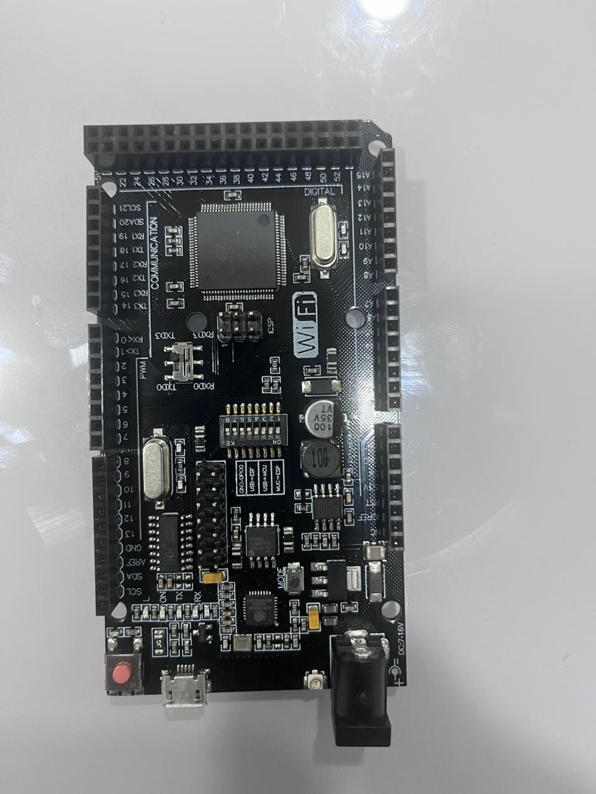
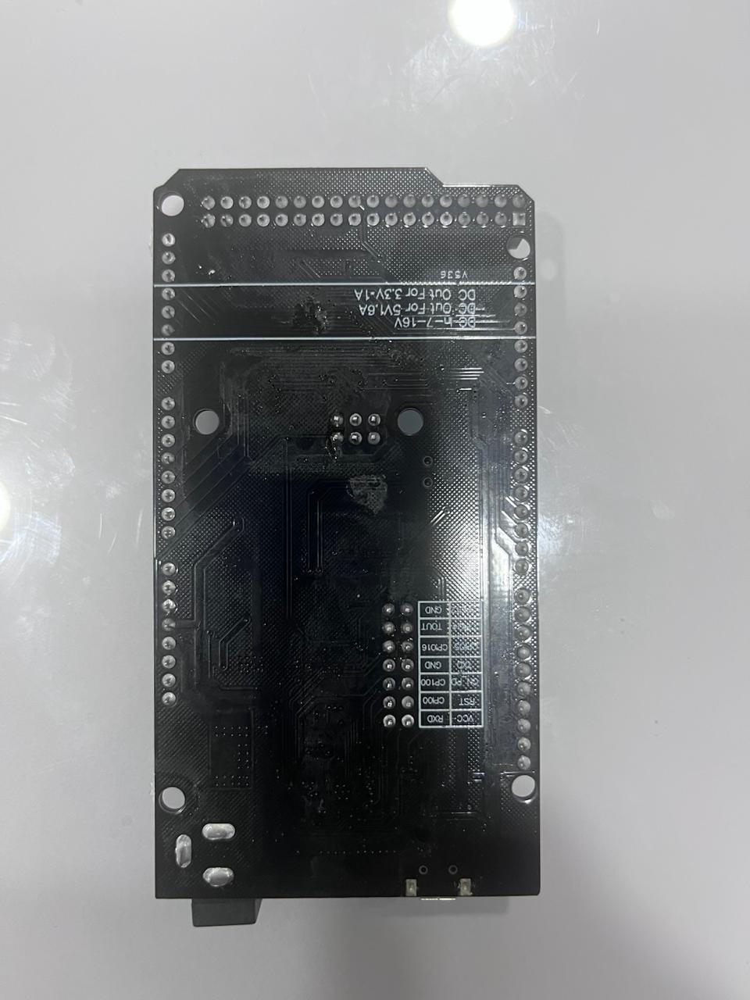
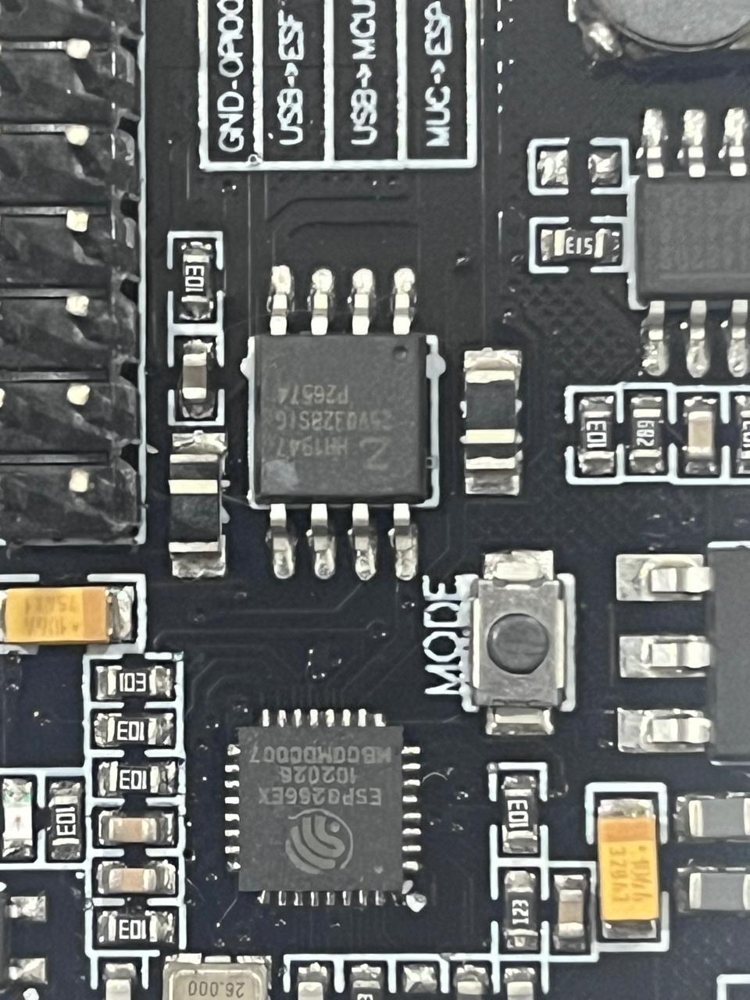
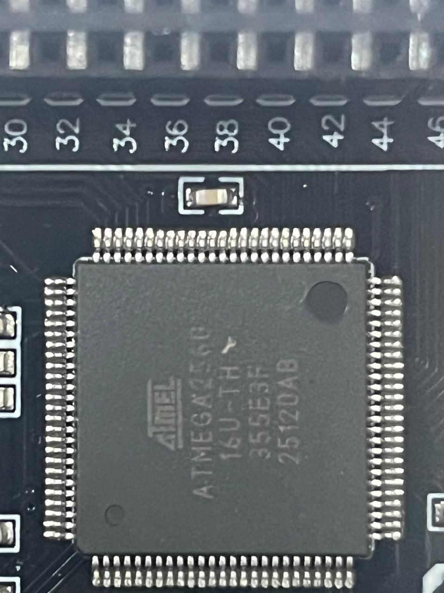

# BIOSECHP — Registro fotográfico del hardware / Hardware Photo Record

**Proyecto / Project:** Mega 2560 + WiFi ESP8266EX — ESP-AT 2.3.0.0 Hardware Adaptation  
**Creador y responsable técnico / Creator and technical lead:** Jorge Eliecer Chacón Pinzón  
**Organización responsable / Responsible organization:** BIOSECHP USA LLC  
**Estado / Status:** Evidencia de una unidad física ensayada / Evidence from one tested physical unit.

## Español

### Imágenes de la unidad evaluada

| Archivo | Descripción |
|---|---|
| [board_front.jpg](images/board_front.jpg) | Cara superior completa de la placa, conectores, banco de ocho DIP y selector UART. |
| [board_back.jpg](images/board_back.jpg) | Cara inferior de la placa; conexiones y serigrafía. |
| [esp8266_flash_detail.jpg](images/esp8266_flash_detail.jpg) | Zona del ESP8266EX y del circuito integrado SPI de 8 terminales. |
| [atmega2560_detail.jpg](images/atmega2560_detail.jpg) | Acercamiento del microcontrolador ATmega2560. |

### Componentes identificados y evidencia

| Elemento | Sustento y límites |
|---|---|
| Microcontrolador ATmega2560 | Marcado visible en la fotografía de detalle; operación comprobada con Blink y sketches Serial3. |
| Microcontrolador ESP8266EX | Marcado visible en la fotografía de detalle; operación comprobada con comandos AT tras la actualización. |
| Interfaz USB-serie CH340 | Identificación funcional previa en Windows como USB-SERIAL CH340 (COM16); confirmar variante exacta del chip mediante macrofotografía si se requiere. |
| Memoria SPI externa de 4 MiB | Capacidad corroborada previamente mediante lectura completa de 4.194.304 bytes con esptool y verificación; el detalle fotográfico muestra el circuito SPI, pero no permite dar por certificado el fabricante/modelo del chip. |
| DIP y selector UART | Banco de ocho interruptores y selector RXD0/TXD0 / RXD3/TXD3 visibles en la cara superior. La configuración ensayada para Serial3 no debe generalizarse a otra revisión de placa. |
| Fabricante y revisión de PCB | **No identificados con certeza.** No atribuir la fabricación a Atmel ni a Espressif solo por sus chips. |

### Verificaciones funcionales relacionadas

- ESP8266 actualizado a **ESP-AT 2.3.0.0**, perfil `WROOM-02-N`.
- `AT`, `AT+GMR` y exploración `AT+CWLAP`: respuestas satisfactorias.
- Comunicación USB ↔ Mega ↔ ESP8266 por `Serial3` a **115200 baudios**: validada.
- Prueba de comandos generados autónomamente por el Mega (`AT`, `AT+GMR`, `AT+CWMODE?`): validada.
- **No ensayado:** conexión autónoma a WiFi ni servidor web como parte de esta campaña.

Ver [docs/VALIDACION.md](../docs/VALIDACION.md) y [README.md](../README.md) para el alcance y las huellas SHA-256 de firmware y sketches.

### Procedencia, seguridad y derechos

Fotografías facilitadas para la documentación de la placa ensayada. **La autorización o licencia de reutilización pública de estas imágenes no está definida**; conservarlas en repositorio privado hasta determinar titularidad, consentimiento y condiciones de publicación. Fotografiar una placa no acredita que BIOSECHP sea su fabricante.

No fotografiar ni publicar etiquetas con contraseñas, números de serie sensibles ni datos personales. Desconectar toda alimentación antes de manipular la PCB.

## English

This folder contains photographs of **one** tested combined Arduino Mega 2560 + WiFi ESP8266EX board: front, rear, ESP8266/SPI-flash area, and ATmega2560 close-up. The board manufacturer and exact PCB revision remain **unconfirmed**. Identification of components is distinct from validation of the functional firmware adaptation.

The ESP8266 responded to ESP-AT 2.3.0.0 AT commands; communication from ATmega2560 via `Serial3` at 115200 baud was tested. Autonomous WiFi association and a browser-based web server were not tested. Photographs remain subject to a separate rights review; no general reuse license is granted here.

**Creator and technical lead:** Jorge Eliecer Chacón Pinzón.  
**Responsible organization:** BIOSECHP USA LLC.  
**Third-party technologies:** Espressif Systems (ESP-AT, ESP8266); ATmega2560 chip branding does not identify the manufacturer of the complete board.
